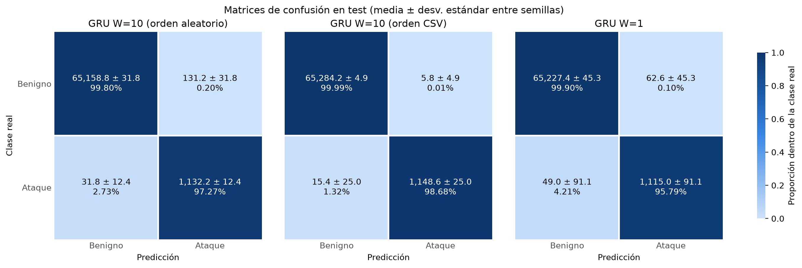
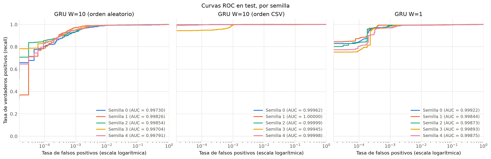
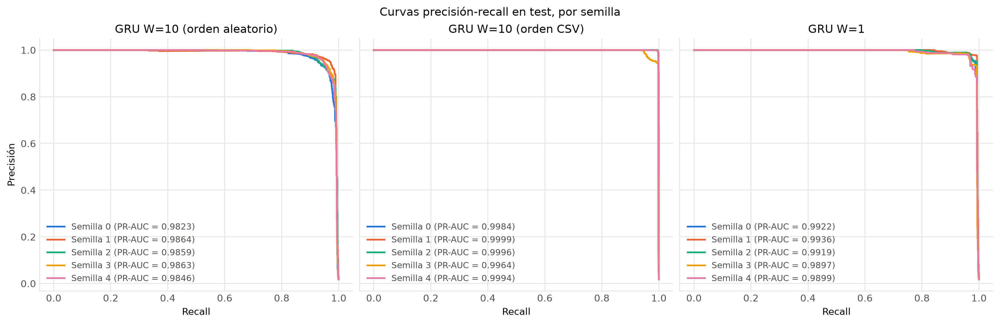
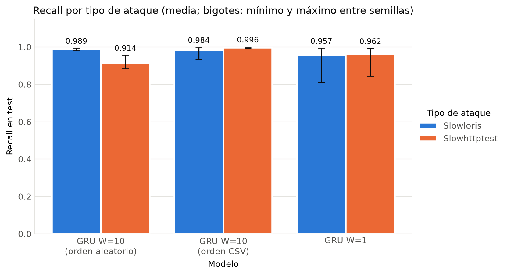
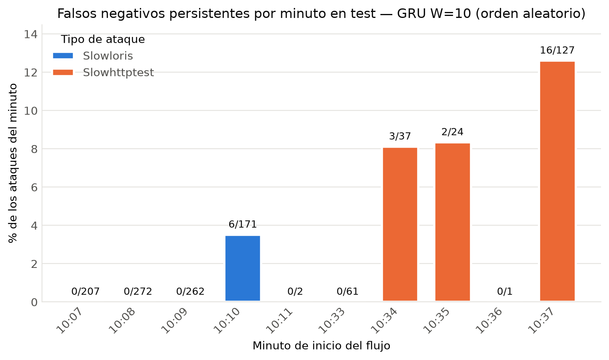
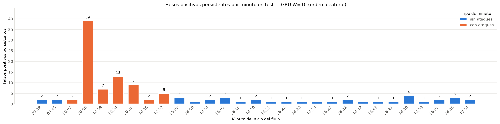

# Resultados del modelo GRU

Detección de ataques Low & Slow (Slowloris y Slowhttptest) con un modelo GRU sobre la captura del miércoles 5/7/2017 de CIC-IDS2017. Todas las cifras se reportan como media ± desviación estándar muestral (ddof = 1) de 5 semillas, salvo que se indique otra cosa. La sección 9 indica el archivo de origen de cada cifra.

## 1. Resumen

El modelo principal es **GRU W=10 (orden aleatorio)**. En el conjunto de prueba (66,454 flujos, 1,164 de ataque):

| Métrica | Valor |
|---|---:|
| Recall | 0.973 ± 0.011 |
| Precision | 0.897 ± 0.022 |
| F1 | 0.933 ± 0.011 |
| F2 | 0.956 ± 0.008 |
| ROC-AUC | 0.9978 ± 0.0006 |
| PR-AUC | 0.985 ± 0.002 |
| Ataques no detectados (FN) | 31.8 ± 12.4 de 1,164 |
| Falsas alarmas (FP) | 131.2 ± 31.8 de 65,290 benignos (0.20 %) |

Hallazgos principales:

- El desempeño del GRU con ventana depende del orden de las filas dentro de cada minuto. Con el orden del archivo, el recall en prueba es de 0.987 ± 0.021 y la precision de 0.995 ± 0.004; ese orden agrupa los flujos por host y no es cronológico, así que esta cifra es una cota optimista.
- Con el orden sorteado dentro de cada minuto, la ventana de 10 flujos no supera al flujo individual (GRU W=1).
- El recall del modelo principal es de 0.989 ± 0.006 en Slowloris y de 0.914 ± 0.030 en Slowhttptest.
- Los errores que se repiten entre semillas son flujos cuyas features se parecen a las de la otra clase.

## 2. Configuración experimental

### 2.1 Datos

El GRU usa el dataset limpio que comparten los tres modelos del proyecto (`data/processed/wednesday_low_and_slow_clean.csv`), con 59 features por flujo. No incluye IPs ni puertos.

| Clase | Entrenamiento | Validación | Prueba | Total |
|---|---:|---:|---:|---:|
| BENIGN | 302,299 | 64,657 | 65,369 | 432,325 |
| DoS Slowhttptest | 4,144 | 1,095 | 260 | 5,499 |
| DoS slowloris | 4,086 | 789 | 915 | 5,790 |
| **Total** | 310,529 | 66,541 | 66,544 | 443,614 |

La partición es cronológica. El día se divide en 5 bloques alrededor de las dos ventanas de ataque, y cada bloque se corta por posición en 70 % / 15 % / 15 %. En los bloques con ataques, las particiones cubren estos tramos:

| Bloque | Entrenamiento | Validación | Prueba |
|---|---|---|---|
| Slowloris | 09:48 – 10:03 | 10:03 – 10:07 | 10:07 – 10:11 |
| Slowhttptest | 10:15 – 10:29 | 10:29 – 10:33 | 10:33 – 10:37 |

### 2.2 Secuencias

- A las features se les aplica `sign(x)·log1p(|x|)` y un `StandardScaler` ajustado solo con entrenamiento.
- Cada entrada es una ventana de W = 10 flujos consecutivos. La etiqueta es la del último flujo (fila objetivo). Las ventanas no cruzan bloques ni particiones.
- El `Timestamp` tiene resolución de un minuto. Se generan dos variantes con las mismas filas en cada partición:
  - **orden CSV:** dentro de cada minuto se conserva el orden del archivo;
  - **orden aleatorio:** el orden dentro de cada minuto se sortea.
- La entrada W = 1 es el último flujo de cada ventana con orden CSV.

| Conjunto | Secuencias | Ataques |
|---|---:|---:|
| Entrenamiento | 310,484 | 8,230 (orden CSV) / 8,224 (orden aleatorio) |
| Validación | 66,496 | 1,884 |
| Prueba (filas comunes evaluadas) | 66,454 | 1,164 |

### 2.3 Modelo y entrenamiento

| Parámetro | Valor |
|---|---|
| Arquitectura | GRU(32) → Dropout(0.3) → Dense(1, sigmoide) |
| Optimizador | Adam, tasa de aprendizaje 0.001 |
| Pérdida | Entropía cruzada binaria |
| Tamaño de batch | 64 |
| Épocas máximas | 50 |
| Parada temprana | `val_loss`, paciencia de 10 épocas, se restauran los mejores pesos |
| Desbalance | Pesos de clase balanceados: 0.514 (BENIGN); 18.86 (ataque) en GRU W=10 (orden CSV) y GRU W=1, y 18.88 en GRU W=10 (orden aleatorio), que tiene 6 ataques menos en entrenamiento |
| Semillas | 0, 1, 2, 3 y 4 |

No se hizo búsqueda de hiperparámetros ni de tamaño de ventana. Las tres variantes usan la misma configuración.

### 2.4 Umbral y métricas

- **Umbral de decisión.** Se elige en validación, por semilla, como el que maximiza F2 en una grid de 0.001 a 0.999. En prueba se aplica ese mismo umbral, sin reelegirlo.
- **Métricas independientes del umbral:** ROC-AUC y PR-AUC.
- **Métricas en el umbral:** recall, precision, F1, F2, accuracy y matriz de confusión.
- En validación se reportan además el recall y la precision con umbral 0.5.

### 2.5 Modelos evaluados

| Modelo | Entrada | Rol |
|---|---|---|
| GRU W=10 (orden aleatorio) | Ventana de 10 flujos, orden sorteado dentro del minuto | **Principal** |
| GRU W=10 (orden CSV) | Ventana de 10 flujos, orden del archivo | Referencia: cota optimista |
| GRU W=1 | Solo el flujo objetivo | Referencia sin ventana |

El modelo principal se designó antes de evaluar en prueba.

## 3. Resultados en validación

Validación tiene 66,496 secuencias, 1,884 de ataque.

### 3.1 Los tres modelos

| Métrica | GRU W=10 (orden aleatorio) | GRU W=10 (orden CSV) | GRU W=1 |
|---|---:|---:|---:|
| `val_loss` | 0.0054 ± 0.0006 | 0.0015 ± 0.0010 | 0.0059 ± 0.0017 |
| ROC-AUC | 0.99984 ± 0.00007 | 0.99998 ± 0.00002 | 0.99965 ± 0.00015 |
| PR-AUC | 0.9966 ± 0.0014 | 0.9995 ± 0.0003 | 0.9931 ± 0.0013 |
| Recall (umbral 0.5) | 0.9759 ± 0.0057 | 0.9959 ± 0.0012 | 0.9805 ± 0.0161 |
| Precision (umbral 0.5) | 0.9704 ± 0.0038 | 0.9868 ± 0.0185 | 0.9640 ± 0.0439 |
| Umbral F2 | 0.094 ± 0.025 | 0.408 ± 0.354 | 0.420 ± 0.390 |
| F2 | 0.9789 ± 0.0054 | 0.9969 ± 0.0014 | 0.9809 ± 0.0105 |
| Recall (umbral F2) | 0.9890 ± 0.0056 | 0.9964 ± 0.0017 | 0.9923 ± 0.0138 |
| Precision (umbral F2) | 0.9409 ± 0.0086 | 0.9987 ± 0.0007 | 0.9403 ± 0.0506 |
| FN (umbral F2) | 20.8 ± 10.6 | 6.8 ± 3.3 | 14.6 ± 25.9 |
| FP (umbral F2) | 117.2 ± 17.9 | 2.4 ± 1.3 | 124.0 ± 109.1 |
| Mejor época | 18.8 ± 8.8 | 6.8 ± 5.8 | 19.6 ± 12.0 |
| Épocas entrenadas | 28.8 ± 8.8 | 16.8 ± 5.8 | 29.6 ± 12.0 |

### 3.2 Modelo principal por semilla

| Semilla | Umbral F2 | Recall | Precision | F2 | FN | FP | PR-AUC |
|---:|---:|---:|---:|---:|---:|---:|---:|
| 0 | 0.106 | 0.9841 | 0.9383 | 0.9746 | 30 | 122 | 0.9945 |
| 1 | 0.125 | 0.9979 | 0.9509 | 0.9881 | 4 | 97 | 0.9983 |
| 2 | 0.066 | 0.9857 | 0.9374 | 0.9756 | 27 | 124 | 0.9972 |
| 3 | 0.070 | 0.9910 | 0.9298 | 0.9781 | 17 | 141 | 0.9961 |
| 4 | 0.103 | 0.9862 | 0.9480 | 0.9783 | 26 | 102 | 0.9968 |

Recall, precision, F2, FN y FP están medidos en el umbral F2 de cada semilla.

### 3.3 Ablaciones

Se compararon con el GRU W=10 (orden CSV) dos variantes que cambian un solo factor: quitar la ventana (W=1) y sortear el orden dentro de cada minuto (orden aleatorio). La regla de decisión se fijó antes de entrenar: hay efecto si la media de `recall_05` o la de `pr_auc` de la variante es menor que la media del GRU W=10 (orden CSV) menos dos veces su desviación estándar.

| Variante | `recall_05` (umbral de la regla: 0.9934) | `pr_auc` (umbral de la regla: 0.9990) | Veredicto |
|---|---:|---:|---|
| GRU W=1 | 0.9805 | 0.9931 | La secuencia aporta |
| GRU W=10 (orden aleatorio) | 0.9759 | 0.9966 | Hay dependencia del orden del CSV |

Las dos variantes quedan por debajo del umbral en ambas métricas.

Comparación descriptiva, sin regla fijada de antemano: con el orden sorteado, W=10 queda al nivel de W=1 (F2 de 0.979 frente a 0.981; FP en el umbral F2 de 117 frente a 124; PR-AUC de 0.9966 frente a 0.9931).

### 3.4 Qué representa el orden del archivo

- El archivo no está en orden cronológico: el 30.6 % de las filas consecutivas retrocede más de 120 s en el tiempo, tanto por inicio como por fin del flujo (32.5 % y 31.6 % con una tolerancia de 60 s).
- Dentro de un mismo minuto, dos filas consecutivas comparten IP de origen el 68.6 % de las veces (21.7 % esperado al azar) e IP de destino el 47.1 % (15.4 % esperado).

El archivo agrupa los flujos por host. Con el orden CSV, los flujos previos de cada ventana suelen venir del mismo host que el flujo objetivo. La ventaja de W=10 con orden CSV en validación se explica por ese agrupamiento y no por un patrón temporal entre flujos. Como el `Timestamp` tiene resolución de un minuto, el orden real dentro del minuto no puede reconstruirse.

## 4. Resultados en test

### 4.1 Filas evaluadas

Los tres modelos se evaluaron sobre las mismas 66,454 filas: las que son fila objetivo tanto en la variante con orden CSV como en la de orden aleatorio.

| Dato | Valor |
|---|---:|
| Filas evaluadas | 66,454 |
| Benignas | 65,290 |
| Ataques | 1,164 |
| DoS slowloris | 914 |
| DoS Slowhttptest | 250 |

Los índices de estas filas están en `results/gru/03_evaluacion_test/idx_test_comun.npy`.

### 4.2 Resumen por modelo

| Métrica | GRU W=10 (orden aleatorio) | GRU W=10 (orden CSV) | GRU W=1 |
|---|---:|---:|---:|
| ROC-AUC | 0.9978 ± 0.0006 | 0.9998 ± 0.0003 | 0.9988 ± 0.0003 |
| PR-AUC | 0.9851 ± 0.0017 | 0.9988 ± 0.0014 | 0.9915 ± 0.0017 |
| Recall | 0.9727 ± 0.0106 | 0.9868 ± 0.0215 | 0.9579 ± 0.0783 |
| Precision | 0.8967 ± 0.0219 | 0.9949 ± 0.0044 | 0.9493 ± 0.0345 |
| F1 | 0.9330 ± 0.0106 | 0.9908 ± 0.0128 | 0.9512 ± 0.0344 |
| F2 | 0.9563 ± 0.0075 | 0.9883 ± 0.0180 | 0.9547 ± 0.0604 |
| Accuracy | 0.9975 ± 0.0004 | 0.9997 ± 0.0004 | 0.9983 ± 0.0011 |
| FN | 31.8 ± 12.4 | 15.4 ± 25.0 | 49.0 ± 91.1 |
| FP | 131.2 ± 31.8 | 5.8 ± 4.9 | 62.6 ± 45.3 |
| Recall en Slowloris | 0.9886 ± 0.0059 | 0.9842 ± 0.0279 | 0.9569 ± 0.0817 |
| Recall en Slowhttptest | 0.9144 ± 0.0296 | 0.9960 ± 0.0040 | 0.9616 ± 0.0658 |

La accuracy es mayor o igual que 0.997 en los tres modelos. Con 98.2 % de filas benignas, no sirve para distinguirlos.

### 4.3 Resultados por semilla

| Modelo | Semilla | Umbral | TN | FP | FN | TP | Recall | Precision |
|---|---:|---:|---:|---:|---:|---:|---:|---:|
| GRU W=10 (orden aleatorio) | 0 | 0.106 | 65,112 | 178 | 31 | 1,133 | 0.9734 | 0.8642 |
| GRU W=10 (orden aleatorio) | 1 | 0.125 | 65,167 | 123 | 17 | 1,147 | 0.9854 | 0.9031 |
| GRU W=10 (orden aleatorio) | 2 | 0.066 | 65,177 | 113 | 41 | 1,123 | 0.9648 | 0.9086 |
| GRU W=10 (orden aleatorio) | 3 | 0.070 | 65,144 | 146 | 23 | 1,141 | 0.9802 | 0.8866 |
| GRU W=10 (orden aleatorio) | 4 | 0.103 | 65,194 | 96 | 47 | 1,117 | 0.9596 | 0.9209 |
| GRU W=10 (orden CSV) | 0 | 0.076 | 65,288 | 2 | 3 | 1,161 | 0.9974 | 0.9983 |
| GRU W=10 (orden CSV) | 1 | 0.239 | 65,285 | 5 | 4 | 1,160 | 0.9966 | 0.9957 |
| GRU W=10 (orden CSV) | 2 | 0.835 | 65,289 | 1 | 7 | 1,157 | 0.9940 | 0.9991 |
| GRU W=10 (orden CSV) | 3 | 0.146 | 65,277 | 13 | 60 | 1,104 | 0.9485 | 0.9884 |
| GRU W=10 (orden CSV) | 4 | 0.744 | 65,282 | 8 | 3 | 1,161 | 0.9974 | 0.9932 |
| GRU W=1 | 0 | 0.010 | 65,165 | 125 | 8 | 1,156 | 0.9931 | 0.9024 |
| GRU W=1 | 1 | 0.472 | 65,260 | 30 | 8 | 1,156 | 0.9931 | 0.9747 |
| GRU W=1 | 2 | 0.113 | 65,230 | 60 | 8 | 1,156 | 0.9931 | 0.9507 |
| GRU W=1 | 3 | 0.507 | 65,203 | 87 | 9 | 1,155 | 0.9923 | 0.9300 |
| GRU W=1 | 4 | 0.999 | 65,279 | 11 | 212 | 952 | 0.8179 | 0.9886 |

- En GRU W=1, cuatro semillas tienen un recall de 0.992–0.993. En la semilla 4, el umbral elegido en validación (0.999) deja 212 falsos negativos. No se corrigió, porque hacerlo sería elegir el umbral con datos de prueba.
- En GRU W=10 (orden CSV), la semilla 3 concentra 60 de los falsos negativos.
- Las métricas independientes del umbral son estables entre semillas: la desviación estándar de ROC-AUC y PR-AUC es menor o igual que 0.002 en los tres modelos.

### 4.4 Lectura de los resultados

- **Modelo principal.** Detecta el 97.3 % de los ataques con 131 falsas alarmas en promedio, el 0.20 % del tráfico benigno.
- **Frente a validación.** En el umbral F2, el recall del modelo principal baja de 0.989 a 0.973 y la precision de 0.941 a 0.897. Prueba corresponde al último 15 % de cada bloque temporal.
- **Ventana frente a flujo individual.** Con el orden sorteado, la ventana no mejora la detección: GRU W=1 tiene mayor recall en cuatro de las cinco semillas, y su F1, ROC-AUC y PR-AUC medios son mayores. El recall medio del modelo principal es mayor (0.973 frente a 0.958) por la semilla 4 de GRU W=1.
- **Orden CSV.** Es el modelo con mejores cifras porque aprovecha el agrupamiento por host del archivo. Es una cota optimista y no el desempeño esperado cuando ese orden no está disponible.

### 4.5 Tiempo de entrenamiento

Por semilla, en CPU:

| Modelo | Tiempo (s) |
|---|---:|
| GRU W=10 (orden aleatorio) | 265.7 ± 56.6 |
| GRU W=10 (orden CSV) | 153.2 ± 41.3 |
| GRU W=1 | 143.8 ± 56.4 |

### 4.6 Figuras

Matrices de confusión (media ± desviación estándar entre semillas):

Curvas ROC por semilla, con el eje de falsos positivos en escala logarítmica:

Curvas precision-recall por semilla:

Recall por tipo de ataque (media; bigotes de mínimo a máximo entre semillas):

## 5. Análisis de errores

Análisis posterior a la evaluación y solo descriptivo: no se tomó ninguna decisión del modelo a partir de él. Un error es **persistente** si ocurre en al menos 3 de las 5 semillas.

### 5.1 Errores persistentes

| Modelo | Error | Filas de la clase | En alguna semilla | Solo en una semilla | Persistentes | En las 5 semillas |
|---|---|---:|---:|---:|---:|---:|
| GRU W=10 (orden aleatorio) | FN | 1,164 | 59 | 24 | 27 | 17 |
| GRU W=10 (orden aleatorio) | FP | 65,290 | 252 | 101 | 115 | 49 |
| GRU W=1 | FN | 1,164 | 212 | 203 | 8 | 8 |
| GRU W=1 | FP | 65,290 | 145 | 66 | 50 | 11 |

En GRU W=1 los errores dependen más de la semilla: de 212 ataques no detectados en alguna semilla, 203 lo son en una sola.

### 5.2 Falsos negativos del modelo principal

Por tipo de ataque:

| Tipo de ataque | Ataques | FN persistentes | % |
|---|---:|---:|---:|
| Slowhttptest | 250 | 21 | 8.4 |
| Slowloris | 914 | 6 | 0.7 |

Por posición en el tramo de ataque de prueba (tres tercios iguales del tiempo entre el primer y el último ataque de cada tipo):

| Tipo de ataque | Posición | Minutos | Ataques | FN persistentes | % |
|---|---|---|---:|---:|---:|
| Slowloris | inicio | 10:07 – 10:08 | 479 | 0 | 0.0 |
| Slowloris | medio | 10:09 | 262 | 0 | 0.0 |
| Slowloris | final | 10:10 – 10:11 | 173 | 6 | 3.5 |
| Slowhttptest | inicio | 10:33 – 10:34 | 98 | 3 | 3.1 |
| Slowhttptest | medio | 10:35 | 24 | 2 | 8.3 |
| Slowhttptest | final | 10:36 – 10:37 | 128 | 16 | 12.5 |

Por minuto:

| Minuto | Tipo de ataque | Ataques | FN persistentes | % |
|---|---|---:|---:|---:|
| 10:07 | Slowloris | 207 | 0 | 0.0 |
| 10:08 | Slowloris | 272 | 0 | 0.0 |
| 10:09 | Slowloris | 262 | 0 | 0.0 |
| 10:10 | Slowloris | 171 | 6 | 3.5 |
| 10:11 | Slowloris | 2 | 0 | 0.0 |
| 10:33 | Slowhttptest | 61 | 0 | 0.0 |
| 10:34 | Slowhttptest | 37 | 3 | 8.1 |
| 10:35 | Slowhttptest | 24 | 2 | 8.3 |
| 10:36 | Slowhttptest | 1 | 0 | 0.0 |
| 10:37 | Slowhttptest | 127 | 16 | 12.6 |

Los falsos negativos persistentes se concentran en el tramo final de cada ataque.

### 5.3 Falsos positivos del modelo principal

| Tipo de minuto | Minutos | Benignos | FP persistentes | % |
|---|---:|---:|---:|---:|
| Con ataques | 10 | 8,336 | 77 | 0.92 |
| Sin ataques | 82 | 56,954 | 38 | 0.067 |

El minuto con más falsos positivos persistentes es 10:08, con 39 de 556 benignos (7.0 %). Le siguen 10:34 (13), 10:35 (9) y 10:09 (7).

### 5.4 Perfil de features por tipo de resultado

Mediana de cada feature, en sus valores originales. Cada fila se clasifica por la predicción mayoritaria de las 5 semillas del modelo principal.

| Feature | TP (1,137) | FN (27) | FP (115) | TN (65,175) |
|---|---:|---:|---:|---:|
| Flow Duration (µs) | 8,537,923 | 192 | 1,667,990 | 30,961 |
| Total Fwd Packets | 2 | 1 | 2 | 2 |
| Total Backward Packets | 1 | 2 | 0 | 2 |
| Fwd Packet Length Mean (bytes) | 8 | 1,448 | 31 | 37 |
| Flow IAT Mean (µs) | 1,710,425 | 96 | 1,635,986 | 12,144 |
| Flow Bytes/s | 24.6 | 10,300,000 | 37.9 | 5,070.6 |
| Init_Win_bytes_forward | 235 | 235 | 395 | 0 |
| Init_Win_bytes_backward | 235 | 235 | −1 | −1 |

- **Falsos negativos.** No tienen el perfil lento de los ataques detectados: duran 192 µs de mediana frente a 8.5 s, y llevan un paquete de tamaño completo (1,448 bytes). Por sus features se parecen al tráfico benigno.
- **Falsos positivos.** Duran 1.7 s de mediana, con un tiempo medio entre paquetes de 1.6 s y sin paquetes de respuesta. Se parecen más a los ataques detectados que al tráfico benigno típico (31 ms de duración mediana).

El dataset no incluye IPs, así que no se puede comprobar si los falsos positivos van dirigidos al servidor atacado.

### 5.5 Coincidencia de errores entre modelos

Errores persistentes del modelo principal y de GRU W=1, sobre las mismas filas:

| Error | En ambos | Solo GRU W=10 (orden aleatorio) | Solo GRU W=1 |
|---|---:|---:|---:|
| FN | 8 | 19 | 0 |
| FP | 32 | 83 | 18 |

Los 8 falsos negativos persistentes de GRU W=1 también lo son del modelo principal, que tiene 19 adicionales. Con orden aleatorio, la ventana agrega errores a los del flujo individual.

## 6. Figuras

Rutas relativas a `results/gru/`:

| Figura | Ruta |
|---|---|
| Matrices de confusión en test | `03_evaluacion_test/matrices_confusion_test.png` |
| Curvas ROC en test | `03_evaluacion_test/curvas_roc_test.png` |
| Curvas precision-recall en test | `03_evaluacion_test/curvas_pr_test.png` |
| Recall por tipo de ataque en test | `03_evaluacion_test/recall_por_tipo_test.png` |
| Falsos negativos persistentes por minuto | `04_analisis_errores/fn_por_minuto.png` |
| Falsos positivos persistentes por minuto | `04_analisis_errores/fp_por_minuto.png` |
| Curvas de entrenamiento por semilla | `01_baseline/baseline_w10_seed{0..4}_curves.png`, `02_ablaciones/aleatorio_w10_seed{0..4}_curves.png` y `02_ablaciones/w1_seed{0..4}_curves.png` |

## 7. Limitaciones

- **Resolución temporal.** El `Timestamp` tiene resolución de un minuto y cada minuto contiene cientos de flujos. El orden real de los flujos dentro del minuto no se conoce, así que ninguna de las dos variantes de W=10 representa la secuencia temporal real.
- **Contenido de la ventana.** El 98.98 % de las ventanas de entrenamiento, el 99.12 % de las de validación y el 98.85 % de las de prueba están formadas solo por flujos del mismo minuto que su fila objetivo. Por la resolución de un minuto, los flujos previos de una ventana pueden haber empezado después del flujo objetivo dentro del mismo minuto. Además, las features de cada flujo se calculan al terminar el flujo, así que el modelo supone flujos completos; la detección en tiempo real está fuera del alcance del protocolo.
- **Sin identificadores de host.** El dataset limpio no incluye IPs ni puertos. No se pueden formar ventanas por host o por conexión.
- **Fragmentos de una conexión entre particiones.** CICFlowMeter divide las conexiones largas en varios flujos consecutivos casi idénticos. Sin hueco entre particiones, fragmentos de una misma conexión pueden quedar a ambos lados de una frontera (los minutos 10:03, 10:07, 10:29 y 10:33 tienen filas en dos particiones) y elevar las métricas de validación y prueba. No se cuantificó (ADR 0010).
- **Orden cronológico solo dentro de cada bloque.** La partición respeta el tiempo dentro de cada bloque, pero no entre bloques: el entrenamiento del bloque de Slowhttptest (10:15 – 10:29) es posterior a la prueba del bloque de Slowloris (10:07 – 10:11). La evaluación no es un pronóstico estricto hacia adelante.
- **Un solo día y un solo escenario.** Los datos son de una captura de un día, con los ataques dirigidos a un mismo servidor desde una misma dirección.
- **Prueba corta.** Prueba cubre unos 4 minutos de cada ataque (el tramo final de cada ventana), con 1,164 ataques. Validación cubre otros 4 minutos.
- **Umbral variable entre semillas.** El umbral F2 elegido en validación va de 0.010 a 0.999 en GRU W=1 y de 0.076 a 0.835 en GRU W=10 (orden CSV). Un umbral extremo puede no trasladarse a prueba.
- **Configuración única.** No se buscaron hiperparámetros ni otros tamaños de ventana. La conclusión sobre la ventana se limita a la configuración evaluada: con ella, W=10 no supera a W=1 cuando el orden se sortea.
- **Vectores repetidos.** 33 filas de ataque de prueba y 121 de validación tienen un vector de features idéntico al de alguna fila de entrenamiento.
- **Análisis de errores descriptivo.** Los patrones de la sección 5 no se pusieron a prueba.
- **Cinco semillas.** Las desviaciones estándar se estiman con 5 corridas.

## 8. Comparación con SVM y XGBoost

SVM y XGBoost deben evaluarse sobre las mismas filas de prueba que el GRU: las de `results/gru/03_evaluacion_test/idx_test_comun.npy`. Ese archivo contiene el índice de `X_test` que devuelve `train_test_split_by_flow()` con sus valores por defecto, así que basta seleccionar `X_test.loc[idx_test_comun]`.

| Modelo | Recall | Precision | F1 | F2 | ROC-AUC | PR-AUC | FN | FP | Tiempo de entrenamiento (s) |
|---|---:|---:|---:|---:|---:|---:|---:|---:|---:|
| GRU W=10 (orden aleatorio) | 0.973 ± 0.011 | 0.897 ± 0.022 | 0.933 ± 0.011 | 0.956 ± 0.008 | 0.9978 ± 0.0006 | 0.985 ± 0.002 | 31.8 ± 12.4 | 131.2 ± 31.8 | 265.7 ± 56.6 |
| SVM | 0.990 | 0.976 | 0.983 | 0.987 | 0.9984 | 0.987 | 12 | 28 | 225.5 (único ajuste final) |
| XGBoost | 0.991 | 0.993 | 0.992 | 0.991 | 0.9999 | 0.998 | 11 | 8 | No reportado |

SVM y XGBoost son una sola corrida cada uno. El tiempo de SVM corresponde al ajuste final con los hiperparámetros elegidos, sin la búsqueda; no es comparable con el tiempo por semilla del GRU.

Clasificación del GRU según la regla del ADR 0021 (intervalo media ± 2·std de las 5 semillas del modelo principal). El veredicto del tercer objetivo específico se basa en recall, F1-score y ROC-AUC; los demás indicadores son complementarios.

| Indicador | Intervalo GRU ± 2σ | SVM | XGBoost | GRU frente a SVM | GRU frente a XGBoost |
|---|---|---:|---:|---|---|
| **Recall** | 0.9514 – 0.9939 | 0.9897 | 0.9905 | Equivalente | Equivalente |
| **F1-score** | 0.9117 – 0.9542 | 0.9829 | 0.9918 | Inferior | Inferior |
| **ROC-AUC** | 0.9965 – 0.9991 | 0.9984 | 0.9999 | Equivalente | Inferior |
| Precision | 0.8528 – 0.9405 | 0.9763 | 0.9931 | Inferior | Inferior |
| F2 | 0.9413 – 0.9714 | 0.9870 | 0.9911 | Inferior | Inferior |
| Accuracy | 0.9967 – 0.9984 | 0.9994 | 0.9997 | Inferior | Inferior |
| PR-AUC | 0.9816 – 0.9885 | 0.9875 | 0.9977 | Equivalente | Inferior |
| Falsos negativos | 7.0 – 56.6 | 12 | 11 | Equivalente | Equivalente |
| Falsos positivos | 67.6 – 194.8 | 28 | 8 | Inferior | Inferior |
| Tasa de falsos negativos (%) | 0.61 – 4.86 | 1.03 | 0.95 | Equivalente | Equivalente |

Origen de las cifras de SVM y XGBoost (filas comunes, 66,454 flujos):

| Modelo | Rama | Archivo |
|---|---|---|
| SVM | `SVM` | `reports/svm/metricas_test_comun_completa.json` (métricas; la tasa de falsos negativos se calcula como `fn` / 1,164); `reports/svm/resultados_completa.json`, campo `tiempo_entrenamiento_final_s` (tiempo) |
| XGBoost | `feature/xgboost-modelo` | `reports/xgboost/resultados_test.json`, campo `subconjunto_comun_gru.metricas_umbral_principal` (métricas, incluida PR-AUC); `reports/metrics/xgboost_comun.json` (accuracy y tasa de falsos negativos; no incluye PR-AUC); `tiempo_entrenamiento_segundos` es `null` |

## 9. Trazabilidad

Rutas relativas a la raíz del repositorio.

| Sección | Cifras | Archivo de origen |
|---|---|---|
| 1, 4.2, 8 | Métricas de prueba, media ± desviación estándar | `results/gru/03_evaluacion_test/test_resultados.json` (campos `media` y `std`) y `tabla_test_resumen.csv` |
| 1, 4.1 | Filas evaluadas, ataques y ataques por tipo | `results/gru/03_evaluacion_test/test_resultados.json` (`n_filas`, `n_ataques`, `ataques_por_tipo`) |
| 4.1 | Filas benignas evaluadas | Output de la sección 2 de `notebooks/gru/03_evaluacion_test.ipynb` |
| 2.1 | Filas por clase y partición; tramos horarios; totales (sumas) | `results/gru/split_verificacion.txt` |
| 2.1 | Número de features | `FEATURE_COLUMNS` en `src/models/gru/sequences.py` |
| 2.2 | Secuencias y ataques de entrenamiento y validación | Outputs de las secciones 2 y 3 de `notebooks/gru/02_ablaciones.ipynb` |
| 2.3 | Configuración de entrenamiento y semillas | Campo `config` y `semillas` de `results/gru/01_baseline/baseline_w10_seeds.json` |
| 2.3 | Pesos de clase | `results/gru/00_datos/pesos_clase.json` (generado por `scripts/gru/conteos_limpieza_y_pesos.py`) |
| 3.1 | Validación, GRU W=10 (orden CSV) | `results/gru/01_baseline/baseline_w10_seeds.json` |
| 3.1, 3.2 | Validación, GRU W=10 (orden aleatorio) | `results/gru/02_ablaciones/aleatorio_w10_seeds.json` |
| 3.1 | Validación, GRU W=1 | `results/gru/02_ablaciones/w1_seeds.json` |
| 3.3 | Medias de las ablaciones y veredictos | `results/gru/02_ablaciones/comparacion.json` |
| 3.3 | Umbrales de la regla | Output de la sección 4 de `notebooks/gru/02_ablaciones.ipynb` |
| 3.4 | Retrocesos de tiempo y coincidencia de IP | Outputs de la sección 5 de `notebooks/gru/02_ablaciones.ipynb` |
| 4.3 | Umbral, matriz de confusión, recall y precision por semilla | `results/gru/03_evaluacion_test/matrices_confusion_test_por_semilla.csv` y `tabla_test_por_semilla.csv` |
| 4.4 | Recall y precision de validación en el umbral F2 | `results/gru/02_ablaciones/aleatorio_w10_seeds.json` (`recall_f2`, `precision_f2`) |
| 4.4 | Proporción de filas benignas (98.2 %) | Calculada con `n_filas` y `n_ataques` de `test_resultados.json` |
| 4.5, 8 | Tiempo de entrenamiento | `results/gru/03_evaluacion_test/tiempo_entrenamiento.csv` |
| 5.1 | Errores persistentes | `results/gru/04_analisis_errores/errores_persistentes.csv` |
| 5.2 | Falsos negativos por tipo, posición y minuto | `results/gru/04_analisis_errores/fn_por_tipo.csv`, `fn_por_posicion.csv` y `fn_por_minuto.csv` |
| 5.3 | Falsos positivos por tipo de minuto y por minuto | `results/gru/04_analisis_errores/fp_por_tipo_de_minuto.csv` y `fp_por_minuto.csv` |
| 5.4 | Perfil de features | `results/gru/04_analisis_errores/perfil_features.csv` |
| 5.5 | Coincidencia de errores | `results/gru/04_analisis_errores/coincidencia_errores.csv` |
| 7 | Vectores repetidos entre particiones; minutos compartidos entre particiones y tramos por bloque | `results/gru/split_verificacion.txt` |
| 7 | Un mismo servidor atacado y una misma dirección de origen | Texto de la sección 3 de `notebooks/Cleaning/limpieza_low_and_slow.ipynb` |
| 7 | Ventanas formadas por flujos de un solo minuto | `results/gru/00_datos/ventanas_un_minuto.json` (generado por `scripts/gru/ventanas_un_minuto.py`) |
| 8 | Métricas de SVM y XGBoost en las filas comunes; clasificación del GRU | Tabla de origen de la sección 8; regla del ADR 0021 |
